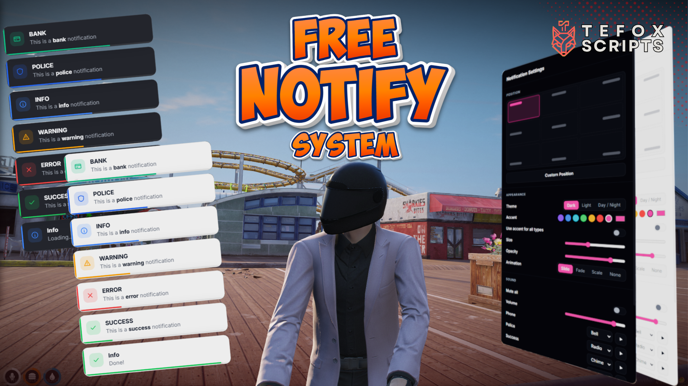
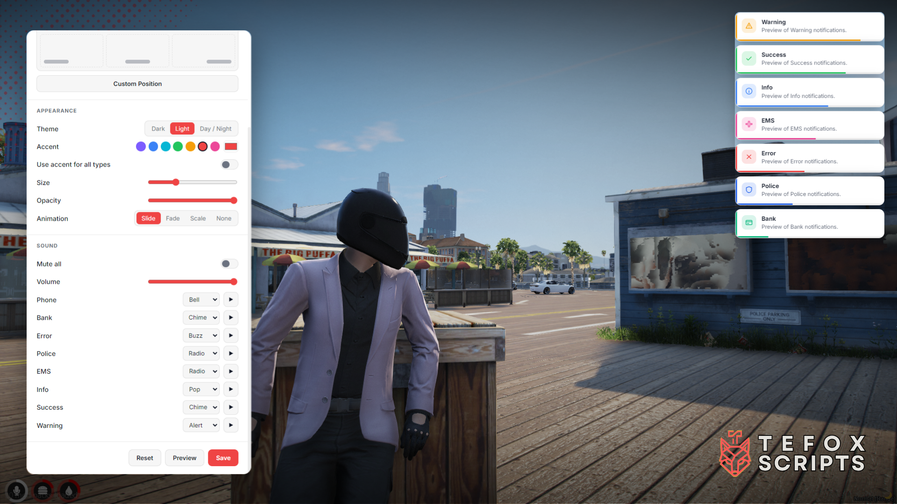
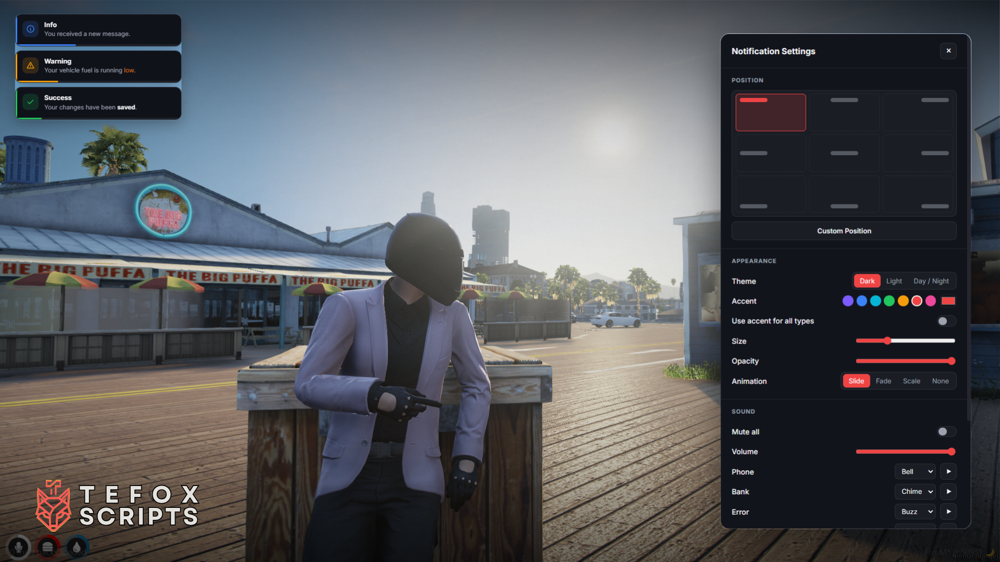
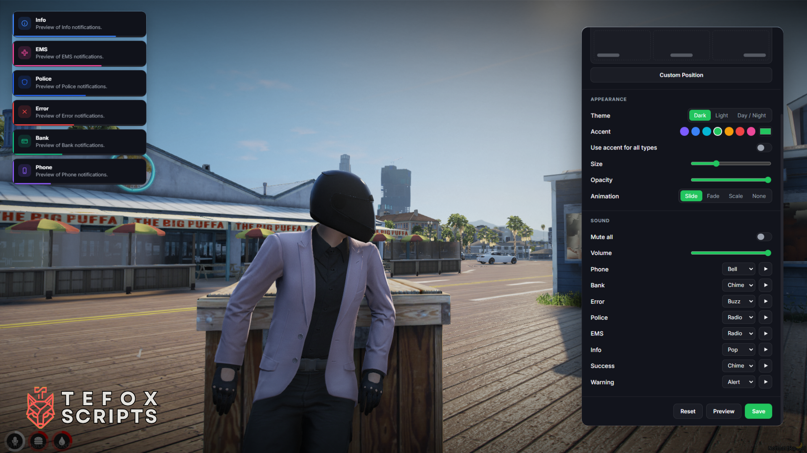

# TEFOX Notify

<p align="center">
  
</p>

<p align="center">
  <a href="https://discord.gg/eWJdBgwD86"></a>
  <a href="https://github.com/Tefox-Scripts/tefox_notify/releases/latest"></a>
  <a href="https://tefox-scripts.com/scripts/16"></a>
</p>

> 💬 **Support, updates and more free scripts are on our [Discord](https://discord.gg/eWJdBgwD86).**

A modern, fully customizable notification system for FiveM.
Works with **QBCore**, **ESX**, **Qbox** and **ox_lib** out of the box, and replaces your server's existing notifications without touching your other scripts.

---

## Features

- Drop-in replacement for QBCore, ESX, Qbox and ox_lib notifications
- In-game settings menu for every player, with live preview
  - 9 screen positions + free drag-and-drop custom position
  - Dark, Light and Day / Night themes
  - Accent color, size, opacity and animation style
  - Per-type sounds, volume and mute
- Player settings saved to the database (with local cache), kept across restarts
- Persistent notifications that can be updated or removed
- Duplicate merging (`x2`, `x3`...) instead of flooding the screen
- Job notifications with on-duty filter (police, EMS, etc.)
- Custom types, icons, colors and sounds
- GTA color codes and **bold** text support
- okokNotify and mythic_notify event compatibility
- Optimized: idle at 0.00 ms

---

## Screenshots

<p align="center">
  
  
  
  
</p>

---

## Requirements

| Resource | Required |
|---|---|
| `oxmysql` | Optional, for saving player settings in the database. Without it, settings are saved locally on each player's PC |
| `ox_lib` | Optional, only if your server uses it |

---

## Installation

### 1. Add the resource

Download **`tefox_notify.zip`** from the [latest release](https://github.com/Tefox-Scripts/tefox_notify/releases/latest) (not "Source code"), extract it and place the `tefox_notify` folder inside your `resources` folder.

> **Important:** The folder name must stay exactly `tefox_notify`, otherwise exports and framework hooks will not work.

### 2. server.cfg

Start it after your database, ox_lib and framework:

```cfg
ensure oxmysql
ensure ox_lib
ensure qb-core
ensure tefox_notify
```

Replace `qb-core` with `es_extended` or `qbx_core` depending on your framework. Remove `ox_lib` if you don't use it.

### 3. Connect your framework

Choose your framework below. This step makes every notification on your server use TEFOX Notify.

#### QBCore

Open `qb-core/fxmanifest.lua` and add this line as the **last entry** of `client_scripts`:

```lua
'@tefox_notify/hooks/qb.lua'
```

Example:

```lua
client_scripts {
    'client/main.lua',
    'client/functions.lua',
    'client/loops.lua',
    'client/events.lua',
    'client/drawtext.lua',
    '@tefox_notify/hooks/qb.lua'
}
```

> Don't forget the comma after the line before it.

#### ESX

Open `es_extended/client/functions.lua`, find:

```lua
function ESX.ShowNotification(message, notifyType, length, title, position)
```

and add this line directly under it:

```lua
    if GetResourceState('tefox_notify') == 'started' then return exports.tefox_notify:Notify({ message = message, type = notifyType, duration = length, title = title }) end
```

Result:

```lua
function ESX.ShowNotification(message, notifyType, length, title, position)
    if GetResourceState('tefox_notify') == 'started' then return exports.tefox_notify:Notify({ message = message, type = notifyType, duration = length, title = title }) end
    ...
end
```

> If your `ESX.ShowNotification` uses different parameter names (for example `msg` instead of `message`), use your names in the line.

#### Qbox

Qbox sends all of its notifications through ox_lib, so only one line is needed.

Open `ox_lib/resource/interface/client/notify.lua`, find:

```lua
function lib.notify(data)
```

and add this line directly under it:

```lua
    if GetResourceState('tefox_notify') == 'started' then return exports.tefox_notify:Notify(data) end
```

Result:

```lua
function lib.notify(data)
    if GetResourceState('tefox_notify') == 'started' then return exports.tefox_notify:Notify(data) end
    ...
```

#### QBCore / ESX servers that also use ox_lib

Do your framework step **and** the ox_lib step above. This covers scripts that call `lib.notify` directly.

### 4. Restart

Restart your **whole server** (not only the framework resource).

> If `tefox_notify` is ever stopped, your server automatically falls back to its original notifications. If you remove it completely, also remove the line you added in step 3.

---

## Configuration

All options are in `config.lua`.

| Option | Description |
|---|---|
| `Config.Framework` | `'auto'`, `'qb'`, `'esx'`, `'qbox'` or `'standalone'` |
| `Config.SettingsCommand` | Command that opens the settings menu |
| `Config.SettingsKey` | Default key for the settings menu (players can rebind it) |
| `Config.Storage` | `'database'` (with local cache) or `'kvp'` (local only) |
| `Config.MaxVisible` | Maximum notifications on screen |
| `Config.Overflow` | `'replace'` removes the oldest, `'queue'` waits |
| `Config.DefaultDuration` | Default duration in ms |
| `Config.MergeDuplicates` | Merge identical notifications into one with a counter |
| `Config.Defaults` | Default settings for new players |
| `Config.Types` | Notification types: title, color, icon and sound |
| `Config.TypeAliases` | Alternative type names |
| `Config.CustomSounds` | Your own sound files |

### Custom sounds

Put your file in `web/sounds/` and register it:

```lua
Config.CustomSounds = {
    siren = 'sounds/siren.ogg',
}
```

It will appear in the player settings menu and can be used in any type.

---

## Client Exports

### Notify

```lua
exports['tefox_notify']:Notify(message, type, duration, title)
```

- `message` (string): Message text
- `type` (string): Notification type (default: `'info'`)
- `duration` (number): Duration in ms (default: `5000`)
- `title` (string): Title (nil for the type's default title)

**Advanced:** pass a table to use extra options.

```lua
exports['tefox_notify']:Notify({
    title = 'Garage',
    message = 'Vehicle **stored**',
    type = 'success',
    duration = 4000,
    icon = 'car',
    color = '#22c55e',
    sound = 'chime',
    persistent = false,
    id = nil,
})
```

- `icon` (string): Icon name or image URL
- `color` (string): Custom hex color
- `sound` (string / false): Override the sound, or `false` for silent
- `persistent` (boolean): Stays until updated or removed
- `id` (string): Custom id. Reusing a visible id updates it

Returns the notification `id`.

**Examples:**

```lua
exports['tefox_notify']:Notify('Action completed!', 'success')

exports['tefox_notify']:Notify('Vehicle stored', 'success', 4000, 'Garage')

exports['tefox_notify']:Notify({ title = 'Achievement', message = 'You did it!', icon = 'star', color = '#eab308' })
```

### Update

```lua
exports['tefox_notify']:Update(id, data)
```

```lua
local id = exports['tefox_notify']:Notify({ message = 'Drilling the vault...', type = 'warning', icon = 'lock', persistent = true })

Wait(10000)

exports['tefox_notify']:Update(id, { message = 'Vault **opened**!', type = 'success', persistent = false })
```

Updatable fields: `title`, `message`, `type`, `icon`, `color`, `duration`, `persistent`.

### Remove / Clear

```lua
exports['tefox_notify']:Remove(id)
exports['tefox_notify']:Clear()
```

### OpenSettings

```lua
exports['tefox_notify']:OpenSettings()
```

---

## Server Exports

### Notify

```lua
exports['tefox_notify']:Notify(source, message, type, duration, title)
exports['tefox_notify']:Notify(source, data)
```

Use `-1` as `source` to send to everyone.

```lua
exports['tefox_notify']:Notify(source, 'You received **$5,000**', 'bank', 5000, 'Bank')
```

### NotifyAll

```lua
exports['tefox_notify']:NotifyAll('Server restart in **10 minutes**', 'warning')
```

### NotifyJob

```lua
exports['tefox_notify']:NotifyJob(job, data, onDutyOnly)
```

```lua
exports['tefox_notify']:NotifyJob('police', {
    title = 'Dispatch',
    message = '10-90 in progress at ~r~Fleeca Bank~s~',
    type = 'police',
    duration = 10000,
}, true)
```

> On ESX servers without a duty system, every player with the job counts as on duty.

### Update / Remove

Server notifications don't return an id, so set your own:

```lua
exports['tefox_notify']:Notify(source, { id = 'heist', message = 'Hacking...', type = 'info', persistent = true })
exports['tefox_notify']:Update(source, 'heist', { message = 'Access granted', type = 'success', persistent = false })
exports['tefox_notify']:Remove(source, 'heist')
```

---

## Events

```lua
TriggerClientEvent('tefox_notify:client:notify', source, message, type, duration, title)
TriggerClientEvent('tefox_notify:client:notify', source, data)
TriggerClientEvent('tefox_notify:client:update', source, id, data)
TriggerClientEvent('tefox_notify:client:remove', source, id)
```

From the client, use `TriggerEvent` with the same arguments without `source`.

---

## Types

| Type | Aliases |
|---|---|
| `success` | |
| `error` | `danger` |
| `warning` | `warn` |
| `info` | `primary`, `inform` |
| `police` | `cop` |
| `ambulance` | `ems`, `medic` |
| `bank` | |
| `phone` | |

## Icons

`check` `x` `alert` `info` `shield` `cross` `card` `bell` `phone` `car` `star` `lock`, or any image URL.

## Sounds

`pop` `chime` `soft` `alert` `buzz` `bell` `radio` `none`, plus anything in `Config.CustomSounds`.

## Text Formatting

| Code | Result |
|---|---|
| `**text**` | Bold |
| `~r~` `~g~` `~b~` `~y~` `~o~` `~p~` `~c~` `~m~` | Red, green, blue, yellow, orange, purple, grey, dark grey |
| `~h~` | Bold |
| `~s~` | Reset formatting |
| `~n~` or `\n` | New line |

---

## Compatibility

If `okokNotify` or `mythic_notify` are **not installed**, scripts that use their events keep working and show TEFOX Notify instead:

```lua
TriggerEvent('okokNotify:Alert', title, message, duration, type)
TriggerEvent('mythic_notify:client:SendAlert', { type = 'success', text = 'Message', length = 5000 })
```

---

## Commands

| Command | Description |
|---|---|
| `/notifysettings` | Opens the settings menu |
| `/announce <message>` | Sends an announcement to all players (admin only) |

To allow admins to use `/announce`, add this to your `server.cfg`:

```cfg
add_ace group.admin command.announce allow
```

---

## Troubleshooting

**Notifications still show the old style**
- QBCore: make sure the hook line is the **last** entry in `client_scripts`.
- ESX: make sure the line is the **first** line inside `ESX.ShowNotification`.
- If your server uses ox_lib, make sure you also added the ox_lib line.
- Restart the whole server, not only the resource.

**Exports don't work**
- The resource folder must be named exactly `tefox_notify`.

**Player settings reset after a restart**
- Make sure `ensure oxmysql` is before `ensure tefox_notify` in `server.cfg`.
- Check the server console. If oxmysql was not found, the script uses local storage only.

**No sound**
- Check that the player didn't enable **Mute all** in the settings menu.

---

## Support

Need help or found a bug? Join our [Discord](https://discord.gg/eWJdBgwD86). It's the fastest way to reach us, and where all updates and new free scripts are announced first.

🛒 More scripts: [tefox-scripts.com](https://tefox-scripts.com)

---

## License

This project is licensed under the [GNU General Public License v3.0](LICENSE).

© TEFOX Scripts
